  

# Hi 👋, I'm Saravanan M

## About me

I'm a software engineer who loves building web applications with Python, Django, React and JavaScript. I enjoy learning new technologies, writing clean code and working on open-source projects.

## "Code until you find your solution"! 👋

  

  

# Python Full Stack Development with AI

A full-stack web application built with Python and integrated with AI features.

## Features

- **Backend:** Built with Python (Flask/Django/FastAPI) to handle APIs and logic.
- **Frontend:** Designed with HTML, CSS, and JavaScript for a responsive interface.
- **Database:** Stores data using MySQL, PostgreSQL, or SQLite.
- **AI Integration:** Adds smart features like chatbots or predictions using AI models and APIs.
- **Authentication:** Secures the app with user login, signup, and token-based access.
- **Version Control:** Manages code and collaboration using Git and GitHub.
- **Deployment:** Hosts the app on platforms like Render, AWS, or Heroku using Docker.

## Languages & Frameworks

  

## Tools I use

  
  

## 📈 GitHub and LeetCode stats

  
  

  

  

## GITHUB TROPHIES

## Connect with me

